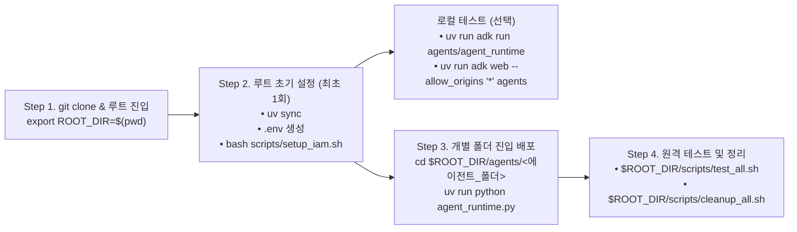

# [Gemini Enterprise Agent Platform](https://docs.cloud.google.com/gemini-enterprise-agent-platform/overview)

## 🏛️ 1. 아키텍처 및 UV Workspace 구조

```text
gemini-enterprise-agent-platform/
├── .env.template                 # 환경 변수 템플릿
├── .env                          # 통합 환경 변수 (루트에서 단일 관리)
├── pyproject.toml                # 루트 UV Workspace 설정 (Python 3.11, ADK 2.13+)
├── agents/                       # 🚀 Agent Runtime 배포 대상 에이전트 패키지 (ADK 모듈 규칙에 따라 _ 사용)
│   ├── agent_runtime/            # 기본 에이전트 (Agent Identity + Memory Bank)
│   ├── agent_registry_mcp/       # Agent Registry MCP 연동 에이전트
│   ├── agent_sandbox/            # Agent Sandbox 격리 코드 실행 에이전트
│   ├── agent_skills/             # Skill Registry 플레이북 검색·로드 에이전트
│   └── graph_workflow/           # ADK 2.0 Graph Workflow + HITL 컨시어지 에이전트
├── notebooks/                    # 📓 Jupyter Notebook 실습 및 평가 환경
│   ├── agent-runtime/            # Agent Runtime 노트북 실습
│   └── agent-eval/               # Agent Evaluation (품질 플라이휠) 실습
└── scripts/                      # 🛠️ 일괄 환경 구성, 테스트 및 리소스 정리 스크립트
    ├── setup_iam.sh              # API 활성화, GCS 버킷 및 통합 서비스 계정(sa-agent-platform)/IAM 일괄 설정
    ├── test_all.sh               # 전체(또는 개별) 에이전트 End-to-End 자동화 테스트
    └── cleanup_all.sh            # 배포된 Reasoning Engine, Sandbox, 서비스 계정(SA) 및 IAM 일괄 정리
```

### 📦 구성 에이전트 패키지 (`agents/`)
1. 📊 **[`agents/agent_registry_mcp`](agents/agent_registry_mcp/README.md)**
   - **역할**: Agent Registry에 등록된 MCP를 연동하여 데이터를 분석하는 에이전트
   - **핵심 기능**: `Agent Registry` \| `MCP Integration` \| `Agent Runtime` \| `Memory Service` \| `Agent Observability`

2. 🌤️ **[`agents/agent_runtime`](agents/agent_runtime/README.md)**
   - **역할**: 날씨, 시간 등 공통 시스템 도구를 탑재한 기본 실행 에이전트
   - **핵심 기능**: `Agent Runtime` \| `Agent Identity` \| `Memory Service`

3. 🛡️ **[`agents/agent_sandbox`](agents/agent_sandbox/README.md)**
   - **역할**: 생성된 코드를 격리된 환경에서 안전하게 실행할 수 있도록 돕는 샌드박스 에이전트
   - **핵심 기능**: `Agent Sandbox` \| `Agent Runtime` \| `Memory Service` \| `Default Agent SA`

4. 📚 **[`agents/agent_skills`](agents/agent_skills/README.md)**
   - **역할**: Skill Registry에서 적절한 스킬(플레이북)을 검색하여 작업을 수행하는 에이전트
   - **핵심 기능**: `Skill Registry` \| `Agent Runtime` \| `Agent Identity`

5. 🔄 **[`agents/graph_workflow`](agents/graph_workflow/README.md)**
   - **역할**: ADK 2.0 Graph Workflow 및 HITL(Human-In-The-Loop) 기반 인터랙티브 컨시어지 에이전트
   - **핵심 기능**: `Graph Workflow` \| `HITL (RequestInput / Resume)` \| `Agent Runtime`

### 📓 실습 및 평가 노트북 (`notebooks/`)
6. 📓 **[`notebooks/agent-runtime`](notebooks/agent-runtime/README.md)** & **[`notebooks/agent-eval`](notebooks/agent-eval/README.md)**
   - **역할**: 노트북 기반 Agent Runtime 실습 및 Agent Evaluation(품질 플라이휠) 환경

### 🧩 UV Workspace (`pyproject.toml`) 동작 원리
* **루트 `pyproject.toml` (워크스페이스 컨트롤 타워)**: `[tool.uv.workspace] members = ["agents/*"]` 설정을 통해 하위 에이전트들의 의존성 합집합을 계산하고, **루트 `.venv`와 `uv.lock` 단 1개만 생성·공유**합니다.
* **에이전트별 `agents/*/pyproject.toml` (개별 명세서)**: 해당 에이전트에 필요한 최소 의존성을 명시하여, 특정 에이전트 폴더만 외부로 복사하더라도 단독 실행(`uv sync`)이 가능하도록 보장합니다.
* **원격 컨테이너 배포 시**: GCP Agent Runtime에 배포할 때는 각 에이전트의 `agent_runtime.py` 내 `agent_runtime_config["requirements"]`에 정의된 패키지 목록이 원격 서버에 설치됩니다.

> **참고**: ADK CLI(`adk run`, `adk web`)는 에이전트 폴더 이름을 Python 모듈 식별자(`^[a-zA-Z0-9_]+$`)로 검증하므로, `agents/` 하위 폴더명은 언더스코어(`_`)를 사용합니다.

---

## 🧭 2. 전체 실행 순서 (`git clone`부터 로컬 실행·배포·테스트·정리까지)



### Step 1. 저장소 클론 및 루트 경로 환경 변수(`ROOT_DIR`) 설정
이후 어느 디렉토리로 이동하든 루트 경로를 바로 참조할 수 있도록 `ROOT_DIR` 환경 변수를 먼저 지정합니다.

```bash
git clone https://github.com/kiwonilee/gemini-enterprise-agent-platform.git
cd gemini-enterprise-agent-platform
export ROOT_DIR=$(pwd)
```

### Step 2. 루트 폴더에서 최초 1회 공통 설정
어느 에이전트를 실행·배포하든 아래 3가지는 **최상위 루트 경로(`${ROOT_DIR}`)에서 최초 1회만** 실행하면 됩니다.

```bash
cd ${ROOT_DIR}

# ① 통합 가상환경(.venv) 생성 및 모든 에이전트 패키지 한 번에 설치
uv sync

# ② 루트에 .env 파일 1개 생성 (하위 에이전트들이 자동으로 상위 .env 참조)
export PROJECT_ID="YOUR_PROJECT_ID"
export STAGING_BUCKET_URI="gs://adk-${PROJECT_ID}"
sed -e "s|your-project-id|${PROJECT_ID}|g" \
    -e "s|gs://your-gcs-bucket|${STAGING_BUCKET_URI}|g" \
    ${ROOT_DIR}/.env.template > ${ROOT_DIR}/.env

# ③ GCP API 활성화, GCS 버킷 생성, 통합 서비스 계정(sa-agent-platform) 및 IAM 권한 일괄 설정
bash ${ROOT_DIR}/scripts/setup_iam.sh
```

### 💻 (선택) 로컬에서 에이전트 즉시 실행 및 디버깅 (`adk run` / `adk web`)
원격 배포 전에 로컬 터미널(CLI)이나 브라우저(Web UI)에서 에이전트를 바로 테스트할 수 있습니다.

```bash
cd ${ROOT_DIR}

# 방법 1: 루트에서 특정 에이전트 CLI 대화형 실행
uv run adk run agents/agent_runtime

# 방법 2: 에이전트 폴더 내부에서 CLI 실행
cd ${ROOT_DIR}/agents/agent_runtime && uv run adk run .

# 방법 3: 5개 에이전트 전체를 로컬 Web UI(http://localhost:8000)로 실행
# (Cloud Shell Web Preview 등 프록시 환경에서 JS 모듈 403 오류 방지를 위해 --allow_origins "*" 포함)
cd ${ROOT_DIR} && uv run adk web --allow_origins "*" agents
```

---

## 🚀 3. Step 3: Agent Runtime 에 원격 배포 (개별 에이전트 폴더 진입)

배포하고자 하는 에이전트 폴더(`${ROOT_DIR}/agents/<에이전트_폴더>`)로 이동한 뒤 `uv run python agent_runtime.py`를 실행하여 배포합니다. 상위 루트의 `.venv`와 `.env`를 자동으로 공유하며, `AGENT_IDENTITY`를 사용하는 에이전트(`agent_runtime` 등)는 배포 직후 콘솔에 출력되는 IAM 권한 부여 명령어를 실행합니다.

```bash
cd ${ROOT_DIR}/agents/agent_runtime
uv run python agent_runtime.py
```

---

## 🔍 4. 공통 API 호출 테스트 가이드 (`scripts/test_all.sh`)

배포된 Reasoning Engine(Agent Runtime)을 자동으로 탐색하여 세션 생성 및 스트리밍 쿼리(HITL 포함) E2E 테스트를 수행합니다.

### 방법 1: 전체 에이전트 일괄 테스트 (추천)
```bash
${ROOT_DIR}/scripts/test_all.sh
```

### 방법 2: 특정 에이전트 개별 테스트
```bash
# 특정 에이전트 이름으로 테스트 (배포된 엔진 ID 자동 조회)
${ROOT_DIR}/scripts/test_all.sh agent_runtime
${ROOT_DIR}/scripts/test_all.sh graph_workflow

# 특정 REASONING_ENGINE_ID를 직접 지정하여 테스트
${ROOT_DIR}/scripts/test_all.sh <REASONING_ENGINE_ID> [agent_registry_mcp|agent_sandbox|agent_skills|agent_runtime|graph_workflow]
```

---

## 🧹 5. 배포 리소스 및 서비스 계정(SA) 일괄 정리 (`scripts/cleanup_all.sh`)

실습 및 테스트가 끝난 후, 과금 방지를 위해 원격 Reasoning Engine(하위 세션·메모리·샌드박스 포함), Agent Identity IAM 바인딩, 그리고 통합 서비스 계정(`sa-agent-platform`) 및 IAM 정책 바인딩을 한 번에 정리할 수 있습니다.

```bash
# 1. 삭제될 대상(Reasoning Engine, Sandbox 컨테이너, SA, IAM 바인딩) 미리보기
${ROOT_DIR}/scripts/cleanup_all.sh --dry-run

# 2. 전체 Reasoning Engine + Sandbox + 통합 서비스 계정(sa-agent-platform) 및 IAM 바인딩 일괄 삭제
${ROOT_DIR}/scripts/cleanup_all.sh

# 3. 확인 프롬프트 없이 즉시 삭제 (Staging GCS 버킷까지 함께 삭제하려면 --include-bucket 추가)
${ROOT_DIR}/scripts/cleanup_all.sh -y

# 4. 서비스 계정(SA)은 유지하고 Reasoning Engine만 삭제하고 싶은 경우
${ROOT_DIR}/scripts/cleanup_all.sh --skip-sa

# 5. 특정 에이전트와 연결된 리소스만 선택 삭제 (공유 서비스 계정은 유지)
${ROOT_DIR}/scripts/cleanup_all.sh agent_sandbox
```

---

## ➕ 6. 신규 에이전트 추가 가이드

루트 `pyproject.toml`이 와일드카드(`members = ["agents/*"]`)로 설정되어 있어, 새 에이전트 추가 시 루트 설정 파일을 수정할 필요가 없습니다.

### 1단계: 에이전트 폴더 생성 및 개별 배포 (필수)
1. 기존 에이전트 폴더를 템플릿 삼아 새 폴더를 복사합니다 (`adk run` 호환을 위해 폴더명에 `_` 사용):
   ```bash
   cp -r ${ROOT_DIR}/agents/agent_runtime ${ROOT_DIR}/agents/my_new_agent
   ```
2. `${ROOT_DIR}/agents/my_new_agent/` 내부의 3개 파일을 수정합니다:
   - **`pyproject.toml`**: `[project] name = "my-new-agent"`로 변경하고 추가 라이브러리가 있으면 `dependencies`에 선언
   - **`agent.py`**: 에이전트 및 도구 로직 구현 (`root_agent` 정의)
   - **`agent_runtime.py`**: `agent_runtime_config` 내 `"display_name"`, `"requirements"`, 인증 방식(`SERVICE_ACCOUNT` 통합 계정 또는 `AGENT_IDENTITY`) 설정
3. 의존성 동기화 후 원격 배포를 수행합니다:
   ```bash
   cd ${ROOT_DIR} && uv sync
   cd ${ROOT_DIR}/agents/my_new_agent
   uv run python agent_runtime.py
   ```

### 2단계: 테스트 및 정리 스크립트(`scripts/*.sh`) 연동 (선택)
인자 없이 `./scripts/test_all.sh`, `./scripts/cleanup_all.sh`를 실행할 때 새 에이전트도 포함하려면 아래 항목만 추가합니다:

| 스크립트 파일 | 추가할 내용 |
| :--- | :--- |
| `scripts/setup_iam.sh` | *(통합 SA `sa-agent-platform`에 추가 IAM 역할이 필요한 경우에만)* `ROLES` 배열에 역할 추가 |
| `scripts/test_all.sh` | `AGENTS` 딕셔너리에 `display_name` 및 테스트용 `prompt` 추가 |
| `scripts/cleanup_all.sh` | `AGENTS` 딕셔너리에 `display_name`, `uses_unified_sa` 추가 |
